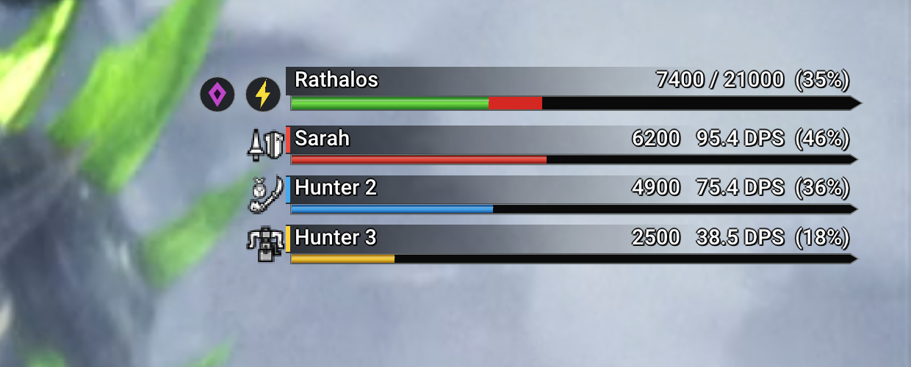

# MHGU Overlay

**An in-game HUD for Monster Hunter Generations Ultimate on [MHGURecomp](https://github.com/morerokk/MHGURecomp):
the health and weaknesses of the monster you are fighting, and a party damage meter with DPS,
drawn inside the game in the style of MHGU's own HUD.**

**No external applications.** It is a small Forge plugin (`.nro`) loaded by the game itself through the
Forge loader that MHGURecomp already includes. Start the game as usual and the HUD is there.



*(Preview with sample data: it appears while the Forge menu is open and you are not fighting)*

## Features

- **Health of the monster you are fighting**: shown as soon as a large monster loses health, and gone
  30 seconds after the last hit (also when it is slain or captured). A monster you lock with the
  target camera always takes the panel.
- **Elemental weaknesses**: up to three element icons next to the monster's health, strongest first,
  read live from the monster's current hitzones.
- **Party damage meter**: one row per hunter (and Palico) with name, damage, DPS, share of the total
  and weapon icon. It can be hidden if you only want the monster's health.
  - Damage is what the game actually applies to that monster, per hunter, online too.
  - **DPS** counts only the time since each hunter joined, so hunters who join later get comparable
    numbers. It stops at the last hit once the monster is slain or captured.
- **Looks like MHGU's HUD**: white names with a dark outline on the HUD's dark fading strip, gauges like
  the hunter's health gauge (green, red for health just lost, pointed end), and the game's player
  colours: P1 red, P2 blue, P3 yellow, P4 green.
- **Scales with your resolution**, with a size slider and a position you can move (by default on the
  right, below the map).
- **Read-only**: it only reads game data. It never changes damage, items, quests or saves.

## Settings

Press **Insert** to open the Forge menu, then **Plugin UI > MHGU Overlay settings**. The settings open
in their own window (it closes with the Forge menu), and while the menu is open you see a preview:

| Option | What it does |
|---|---|
| Show party damage meter | Untick to show only the monster's health and weaknesses. |
| Damage meter shows | `Damage`, `DPS` or `Damage + DPS`. |
| Size | Extra scale on top of the automatic one (1.00 = default). |
| Right edge / Top | Where the panel goes (share of the screen). **Reset position** goes back to the default. |
| Monster bar / Your bar / Other hunters | Your own bar colours. **Reset colours** goes back to the game's. |

Changes apply at once and are saved to `mhgu_overlay.ini` next to your saves
(`%APPDATA%\MHGURecomp\save\save_0\` on Windows).

## Requirements

| What | Version | Notes |
|---|---|---|
| [MHGURecomp](https://github.com/morerokk/MHGURecomp) | tested with 0.15.3 | Includes the Forge plugin loader (1.5.1). |
| MHGU game data | **1.4.0** (English) | On other versions the party damage meter turns itself off. |

## Installation

1. Download `mhgu-overlay.zip` from the [Releases](../../releases) page.
2. Extract it into the `mods` folder of MHGURecomp, so that you get
   `mods\mhgu-overlay\romfs\nativeNX\plugins\mhgu_overlay.nro`.
3. Add a line `mhgu-overlay` to `mods\load_order.txt` (at the top is fine).
4. Start the game. In `log.txt` you should see `MHGU Overlay: party damage hooks installed`.

To remove it, delete `mods\mhgu-overlay` and its line in `load_order.txt`.

It works together with other Forge plugins, including Damage Numbers and HuntLog (they chain on the
same game functions).

## Building

Needs Rust `nightly-2026-11-02` with `rust-src` (installed automatically by `rust-toolchain.toml`) and
Python 3:

```sh
cargo +nightly-2026-11-02 build --release --locked
python tools/elf_to_nro.py target/armv7a-none-eabi/release/libmhgu_overlay.so mhgu_overlay.nro
```

## Credits

- Game research (monster, party and hit data, target camera, weapon icons) comes from
  [HuntLog](https://github.com/Rikiar73574/mhgu-huntlog) by Riccardo Testa, which adapts
  [MHGU-DPS-Meter](https://github.com/sadgnk169/MHGU-DPS-Meter) by sadgnk169 (both MIT).
- [forge-rs](https://github.com/Lawrence-al/forge-rs) and [MHGU Forge](https://github.com/Fexty12573/forge)
  by Fexty (MIT); [MHGURecomp](https://github.com/morerokk/MHGURecomp) by Rokk (MIT).
- Weapon icons: [MHGenDatabase](https://github.com/gatheringhallstudios/MHGenDatabase) classic artwork (MIT).
- Font: [Roboto](https://fonts.google.com/specimen/Roboto) (Apache 2.0).
- Sister project: [MH World Overlay](https://github.com/Ohhvalvaa/mh-world-overlay).

License notices are in [`licenses/`](licenses). Monster Hunter is a trademark of CAPCOM; this is an
unofficial fan project, not affiliated with CAPCOM.

---

### In italiano

Overlay dentro il gioco per MHGU su MHGURecomp: vita e debolezze del mostro che stai combattendo e
danni del gruppo con DPS, nello stile dell'HUD di MHGU. Si installa copiando la cartella
`mhgu-overlay` in `mods` e aggiungendo la riga `mhgu-overlay` a `mods\load_order.txt`. Impostazioni:
**Ins > Plugin UI > MHGU Overlay settings**.
